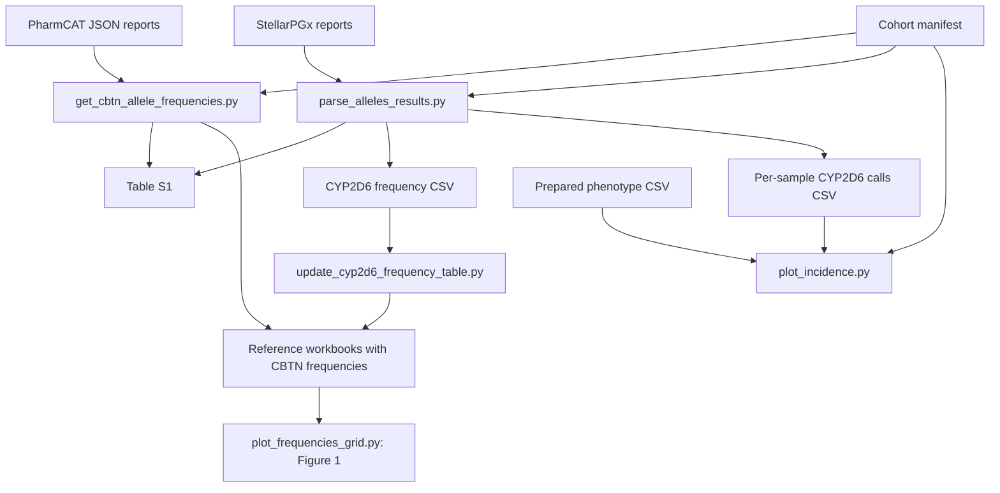

# Manuscript pharmacogenomics analysis workflow

This directory contains the scripts used to summarize cohort pharmacogenomic
calls, generate supplementary Table S1, populate observed allele frequencies in
reference workbooks, produce **manuscript Figure 1**, and summarize phenotype
actionability. The workflow starts with completed PharmCAT and StellarPGx
reports and a defined sample cohort. Genotype calling and reference-table
acquisition occur upstream.

## Workflow overview

1. Prepare the cohort manifest, caller reports, reference workbooks, and phenotype
   table described below.
2. Summarize non-CYP2D6 alleles with `get_cbtn_allele_frequencies.py`.
3. Aggregate CYP2D6 calls with `parse_alleles_results.py`.
4. Update the CYP2D6 workbook with `update_cyp2d6_frequency_table.py`.
5. Generate manuscript Figure 1 with `plot_frequencies_grid.py`.
6. Generate phenotype/actionability tables and plots with `plot_incidence.py`.

Steps 2 and 3 both contribute to Table S1 and may run in either order. Run both
workbook updates before generating Figure 1.



## Software and script files

Use Python 3.10 or later with `numpy`, `pandas`, `matplotlib`, and `openpyxl`.
For example, from this directory:

```bash
python3 -m venv .venv
source .venv/bin/activate
python3 -m pip install numpy pandas matplotlib openpyxl
```

Record the package versions used for the manuscript analysis with the released
results. The command above installs dependencies without pinning versions.

| Script | Role |
| --- | --- |
| [get_cbtn_allele_frequencies.py](get_cbtn_allele_frequencies.py) | Counts PharmCAT allele occurrences, writes frequency and diagnostic CSVs, contributes non-CYP2D6 Table S1 rows, and updates non-CYP2D6 workbooks. |
| [parse_alleles_results.py](parse_alleles_results.py) | Aggregates StellarPGx CYP2D6 reports into per-report calls, cohort frequencies, and CYP2D6 Table S1 rows. Earlier workflow instructions refer to this aggregation step as `aggregate_stellarpgx_calls.py`. |
| [sample_star_allele_table.py](sample_star_allele_table.py) | Shared helper imported by both counting scripts to write Table S1 while preserving the other caller's genes. |
| [update_cyp2d6_frequency_table.py](update_cyp2d6_frequency_table.py) | Maps prepared CYP2D6 frequencies to existing workbook allele rows and updates the CBTN column. |
| [plot_frequencies_grid.py](plot_frequencies_grid.py) | Generates manuscript Figure 1 from the populated reference workbooks. |
| [plot_incidence.py](plot_incidence.py) | Produces sample-level phenotype distributions and actionable-phenotype fractions. |
| [phenotype_plot_utils.py](phenotype_plot_utils.py) | Shared phenotype loading, classification, and conflict-resolution rules imported by the phenotype plotting script. |

Keep both helper modules beside the scripts that import them. The publication
directory uses regular script files; when packaging other repository entry
points, include the targets of any symlinks as well.

## Input layout

Run the commands below **from `PublicationResources/`**. Populate or link the
input directories and files into this layout before running. The data inputs
are separate from the Python source files.

```text
PublicationResources/
├── README.md
├── get_cbtn_allele_frequencies.py
├── parse_alleles_results.py
├── sample_star_allele_table.py
├── update_cyp2d6_frequency_table.py
├── plot_frequencies_grid.py
├── plot_incidence.py
├── phenotype_plot_utils.py
├── sample-cohort-manifest.txt
├── shared_pharmcat_cyp2d6_samples.txt  # same IDs; legacy plotting filename
├── alleles_and_phenotypes.csv
├── PharmCatCalls/
│   └── *.subset.phenotype.json
├── StellarPGxCalls/
│   └── *.alleles
├── DiplotypeFrequencies/
│   └── <GENE>_frequency_table.xlsx
└── Cyp2d6-Processing/
    ├── alleles_results.csv           # generated in step 3
    └── haplotype_frequencies.csv     # generated in step 3
```

### Cohort manifest

`sample-cohort-manifest.txt` contains one canonical sample ID per line. Both
allele-counting scripts use this filename by default. Blank lines are ignored.

`plot_incidence.py` currently reads the older filename
`shared_pharmcat_cyp2d6_samples.txt` beside the plotting script. Give it the same
cohort, for example by creating this relative symlink in a new analysis directory:

```bash
ln -s sample-cohort-manifest.txt shared_pharmcat_cyp2d6_samples.txt
```

If both manifests already exist, their sample-ID sets must agree. The scripts do
not automatically synchronize them.

### Caller reports

- **PharmCAT:** JSON files matching `PharmCatCalls/*.subset.phenotype.json` with
  gene reports under `geneReports -> CPIC -> <GENE> -> sourceDiplotypes`.
  Named `allele1` and `allele2` entries supply allele occurrences. A leading
  `_<numeric batch>_` filename prefix is removed before manifest matching.
- **StellarPGx:** text reports matching `StellarPGxCalls/*.alleles`, containing
  Result, Activity score, and Metabolizer/Metaboliser status fields. The parser
  derives sample IDs by removing `.filtered_ctrl_cyp2d6.alleles`, or otherwise a
  final `.alleles`. It does not remove PharmCAT-style batch prefixes.

Search is nonrecursive by default. The StellarPGx parser accepts `--recursive`.
Use one intended report per sample; duplicate files are not deduplicated during
allele counting.

### Reference workbooks

Prepare a `<GENE>_frequency_table.xlsx` for each gene to analyze in
`DiplotypeFrequencies/`. Each needs:

- An `Allele frequency` worksheet, placed first for the grid plotting script.
- Headers on Excel row 2 and allele labels in column A, beginning on row 3.
- Numeric ancestry-reference frequencies expressed as proportions from 0 to 1.
- An appended `CBTN` column for observed cohort frequencies.

The CYP2D6 updater additionally requires `CYP2D6 allele` in A2 and, by default,
`CBTN` in K2. Its `--column` option can select another CBTN column. Workbooks
must exist before counting/updating; the scripts do not create missing allele
rows. Retain the reference-table source and version with the analysis inputs.

### Phenotype input table

`alleles_and_phenotypes.csv` is a headerless table with these nine columns:

```text
sample_id,case_id,disease_type,primary_site,biospecimen_id,authority,gene,diplotype,phenotype
```

The phenotype loader uses sample ID, authority, gene, diplotype, and phenotype;
the four demographic fields retain their positions but are not analyzed here.
Both CPIC and DPWG records can be present. The plotting script selects DPWG for
VKORC1 and CPIC for the other genes.

The full repository's `parse_pharmcat_outputs.py` can generate this format from
`metadata.csv` and `CavaticaFiltered/Data/*.subset.phenotype.json`. It is an
upstream preparation script outside this publication directory and writes its
output to its working directory; place or link that output here. The allele
counting script does not generate this phenotype CSV.

## Running the analysis

Start at the repository root and enter the publication directory:

```bash
cd PublicationResources
```

The commands below assume the input layout above is prepared.

### 1. Count PharmCAT alleles and initialize its Table S1 rows

```bash
python3 get_cbtn_allele_frequencies.py
```

This updates the existing non-CYP2D6 workbooks and writes `alleles_freqs.csv`,
`alleles_freqs_gene_summary.csv`, and the PharmCAT rows of
`table-s1-sample_star_allele.csv`. CYP2D6 is intentionally excluded from this
counting route.

### 2. Aggregate StellarPGx CYP2D6 calls

```bash
python3 parse_alleles_results.py \
  --input-dir StellarPGxCalls \
  --sample-allowlist sample-cohort-manifest.txt \
  --output Cyp2d6-Processing/alleles_results.csv \
  --haplotype-output Cyp2d6-Processing/haplotype_frequencies.csv
```

The explicit output paths connect the parser to the workbook updater and
phenotype plot. Without these overrides, the parser writes its calls and
frequency CSVs directly in the working directory. Output parent directories
are created by the parser.

It also writes CYP2D6 rows to the same Table S1 used in step 1. The calls CSV
contains all parsed reports; the frequency CSV and Table S1 use the allowlist.
Missing/unparseable cohort results remain in Table S1 with zero counted alleles.

### 3. Populate the CYP2D6 workbook

```bash
python3 update_cyp2d6_frequency_table.py
```

The defaults now align with the files generated in step 2. The updater sums
frequencies that map to the same existing workbook label and reports unmatched
input labels and workbook rows left blank. It updates the workbook in place.

### 4. Produce manuscript Figure 1

```bash
python3 plot_frequencies_grid.py
```

Figure 1 is saved at
`DiplotypeFrequencies/all_genes_allele_frequencies_grid.png` at 300 dpi. Each gene
panel shows selected reference-frequency ranges, observed CBTN frequencies, and
ancestry-calculated frequencies. The grid retains at most ten eligible alleles
per gene, ranked by observed frequency; it does not display every counted allele.

### 5. Produce phenotype/actionability results

```bash
python3 plot_incidence.py
```

This uses the prepared phenotype CSV, the legacy-named cohort manifest, and the
per-sample CYP2D6 calls from step 2. It produces the Boolean sample/actionability
table, a per-gene summary, a stacked fraction plot, and phenotype pie charts.
These are sample-level proportions; the historical script name does not denote
a longitudinal incidence-rate analysis.

## Output reference

Paths below are relative to `PublicationResources/` when using the commands above.

| Output | Contents |
| --- | --- |
| `alleles_freqs.csv` | Headerless PharmCAT frequency table: gene, allele, frequency, occurrence count, gene-specific denominator. |
| `alleles_freqs_gene_summary.csv` | Per-gene report/diplotype counts and ambiguity diagnostics. |
| `Cyp2d6-Processing/alleles_results.csv` | Parsed StellarPGx calls, activity scores, metabolizer statuses, and haplotype tokens for all matched reports. |
| `Cyp2d6-Processing/haplotype_frequencies.csv` | Cohort-filtered CYP2D6 haplotype counts, per-report presence counts, and frequencies rounded to six decimal places. |
| `table-s1-sample_star_allele.csv` | Combined supplementary Table S1, described below. |
| `DiplotypeFrequencies/*_frequency_table.xlsx` | Existing reference workbooks with updated observed CBTN values. |
| `DiplotypeFrequencies/all_genes_allele_frequencies_grid.png` | Manuscript Figure 1. |
| `actionable_phenotypes_table.csv` | One row per represented sample, Boolean actionability for each gene, and an Aggregate column. |
| `phenotype_data_table.csv` | Per-gene actionable counts, available-sample denominators, fractions, and an aggregate row. Legacy column names use “Interesting Phenotypes” for actionable phenotypes. |
| `actionable_phenotypes_fraction_with_aggregate_and_stacked.png` | Actionable fractions and their complements by gene, plus Aggregate. |
| `all_phenotype_pie_charts.png` and `.svg` | Per-gene distributions of resolved phenotype categories. |

### Table S1 schema

| Column | Meaning |
| --- | --- |
| `sample_id` | Caller-derived sample ID, restricted to the cohort manifest. |
| `gene` | PharmCAT target gene or CYP2D6 from StellarPGx. |
| `source_diplotype_count` | Number of PharmCAT source diplotypes; for StellarPGx, one for a parseable Result and zero otherwise. |
| `counted_alleles` | Number of named PharmCAT allele entries or parsed StellarPGx haplotype tokens. |
| `labels_preview` | Up to ten PharmCAT source-diplotype labels, or the extracted StellarPGx Result text. |

This is a per-report/per-gene table, not one row per allele. Each writer replaces
its own genes and preserves the other caller's rows. Reruns do not append the
same gene's previous output; duplicate source reports can still produce repeated
sample/gene rows. An existing table must have the exact five-column header.
The scripts generate CSV output; spreadsheet formatting or additional manuscript
tables such as Table S2 are separate from these exports.

## Analysis assumptions and reproducibility

- **Allele denominators:** PharmCAT counts every named allele in every source
  diplotype, including alternative diplotypes. StellarPGx counts parsed
  slash-delimited tokens. Neither route expands copy-number labels into physical
  gene copies. Denominators are counted occurrences, not twice the manifest size.
- **DPYD:** bracketed combination labels are split into components while keeping
  the original denominator. Component frequencies can sum to more than one.
- **Workbook matching:** only existing allele rows receive values. Unmatched
  rows are blank, not explicit zero. CYP2D6 copy-number grouping follows the
  updater's current pattern, which accepts suffixes beginning with digits 3–9
  but misses labels such as `x10` and `x20` unless they match a workbook row exactly.
- **Figure 1:** ancestry weights are fixed in the script, using counts AFR=153,
  AMR=222, EAS=67, EUR=968, and SAS=42. Latino receives the full AMR weight;
  missing selected reference values contribute zero without renormalizing the
  weights. Reference columns are selected positionally from Excel B–I, so verify
  that slice: a CBTN column inside it affects eligibility and min/max ranges.
  Panels follow unsorted filesystem order and the layout supports at most 16
  genes. Review the Figure 1 script documentation for marker and display limits.
- **Phenotypes:** `phenotype_plot_utils.py` defines the study's actionable sets
  and resolves each sample/gene to one phenotype. Unrecognized categories are
  treated as non-actionable with warnings. Per-gene denominators include only
  represented sample/gene rows; the aggregate denominator includes samples with
  any resolved row. Neither denominator is necessarily the manifest size.
  Pie categories below 0.05% are omitted and displayed percentages are
  renormalized over the retained categories.

Workbook updates and generated files overwrite their destinations. Archive the
input manifest, caller outputs, reference-table versions, helper definitions,
and software versions with the results. Review the scripts' printed counts and
unmatched-label reports when reproducing the manuscript outputs.

## Optional steps in the full repository

`build_shared_pharmcat_cyp2d6_samples.py`, outside this directory, builds a shared
manifest from `metadata.csv`, the CYP2D6 calls table, and PharmCAT filenames. It
currently writes `shared_pharmcat_cyp2d6_samples.txt`; align its reviewed output
with `sample-cohort-manifest.txt` before running this workflow. It requires an
existing CYP2D6 calls table, so the publication workflow above starts with a
prepared manifest rather than assuming that builder is a bootstrap step.

The full repository also provides an optional deviation analysis, run from this
directory after updating the workbooks:

```bash
python3 ../plot_frequency_deviations.py --input-dir DiplotypeFrequencies
```

It exports the distribution of observed minus ancestry-calculated frequencies
in percentage points, plus allele-level inclusion and reference-coverage data.
It includes all comparable workbook alleles rather than Figure 1's top-ten
selection and is separate from the Figure 1 generation script.
